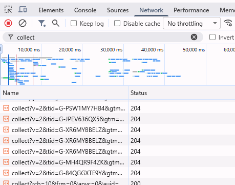
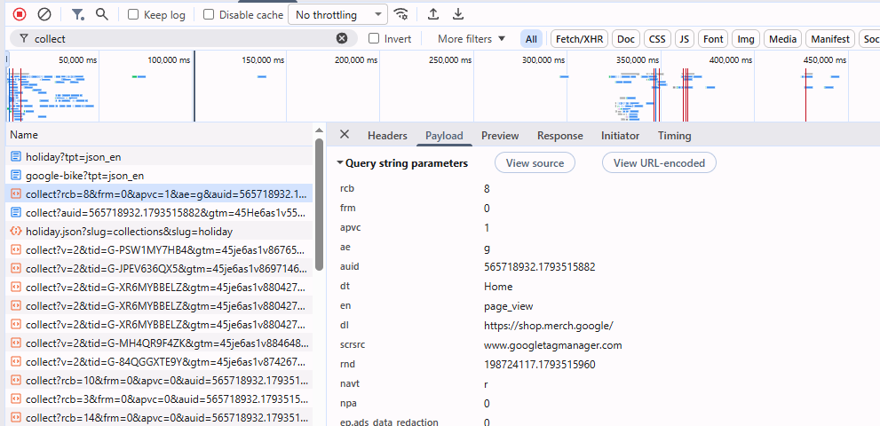

# Домашняя работа № 1 · Путь данных от ссылки до заявки

**Дисциплина:** ОП.03 «Информационные технологии»

| Поле | Значение |
|---|---|
| Фамилия, имя, отчество | Станчинская Соня |
| Группа | РПО 25/9/3 |
| Номер работы | 1 |
| Тема работы | Цифровая воронка: путь данных от ссылки до заявки |
| Дата сдачи | пу пу пуу... |

---

## Задание

1. Открыть сайт, панель разработчика (F12) → **Network**, в фильтре `collect`,
   галочка **Preserve log**.
2. Сделать три действия: обновить страницу, прокрутить до низа, нажать
   на товар. Записать, какие события ушли — параметр `en` на вкладке **Payload**.
3. Описать путь пользователя от ссылки до заявки, пять шагов.
4. Найти одно место на этом пути, где данные могут потеряться.
5. Приложить скриншоты `screens/01-network.png` и `screens/02-payload.png`.

Сайт: https://shop.merch.google/, запасные — https://habr.com/ru/,
https://www.smashingmagazine.com/, https://css-tricks.com/. Открывать
в Chrome или Edge с выключенным блокировщиком рекламы.

Срок — до начала занятия 2. Работа сдаётся коммитом в `main`.

---

## 1. Какой сайт смотрел

| Поле | Значение |
|---|---|
| Название сайта | Google Merchandise Store |
| Адрес | https://shop.merch.google/ |
| Откуда сайт | из списка в задании |

## 2. Три действия и что отправил счётчик

Панель Network, фильтр `collect`, галочка Preserve log. Название события
лежит в параметре `en` на вкладке Payload.

В первой строке стоит пример. **Удалите его** и впишите свои три.

| № | Что я сделал на сайте | Название события (`en`) | Что ещё было в Payload |
|---|---|---|---|
| 1 | обновил страницу (F5) | `page_view` | `dl` (https://shop.merch.google/), `dt` (Home) |
| 2 | прокрутил до низа | `scroll` | `epn.percent_scrolled=90` |
| 3 | нажал на товар | `page_view` | `dl` (https://shop.merch.google/shop/lifestyle/bags), `dt` (
Bags | Google Merch Shop)  |

Скриншоты:

Панель Network со списком запросов 

Вкладка Payload одного события 

## 3. Путь пользователя: 5 шагов

От ссылки до заявки, своими словами. Панель для этого не нужна: это рассказ
о том, как человек доходит до кнопки «Отправить». В правом столбце стоит
пример, в левом вы пишете свой вариант.

| № | Мой шаг | Пример |
|---|---|---|
| 1 | открыть ссылку по причине домашки | *человек увидел ссылку в сообществе и нажал на неё* |
| 2 | открылась главная страница сайта https://shop.merch.google/ | *открылась главная страница сайта* |
| 3 | прокрутить до конца | *он прокрутил до формы записи* |
| 4 | найти плюшевого android | *начал заполнять: имя и телефон* |
| 5 | нажать на него, затем в корзину, оформить заказ | *нажал «Отправить», заявка ушла менеджеру* |

# 4. Где данные могут потеряться

| № | На каком шаге | Что может потеряться |
|---|---|---|
| 1 | Шаг 1, переход по ссылке | В ссылке нет UTM-метки, и в заявке не видно, откуда пришел человек (пишется `direct`). |
| 2 | Шаг 4-5, нажатие «Отправить» | Если у пользователя включен AdBlock, скрипт GA4 (запрос `collect`) может быть заблокирован, и событие `generate_lead` не дойдет до аналитики, хотя заявка в таблицу упадет. |

## 5. Использование ИИ

| Вопрос | Ответ |
|---|---|
| Что сделал сам | Открывал панель Network, фильтровал запросы, искал параметр `en` в Payload, описывал путь пользователя. |
| Что спросил у модели | Помощь в расшифровке параметров `dl` и `dt`, а также проверка логики шагов воронки. |
| Что после этого изменил | Добавил в таблицу действий реальное название события, которое увидел в браузере (вместо предположения). |
