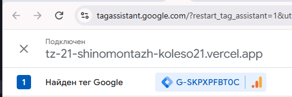
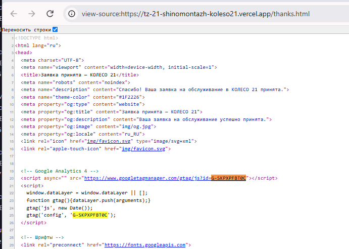
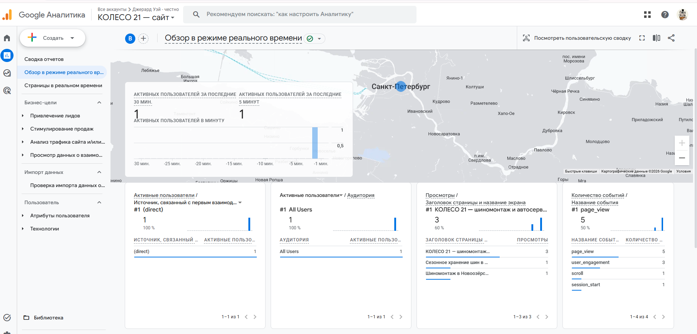
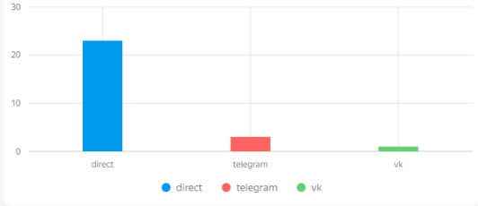
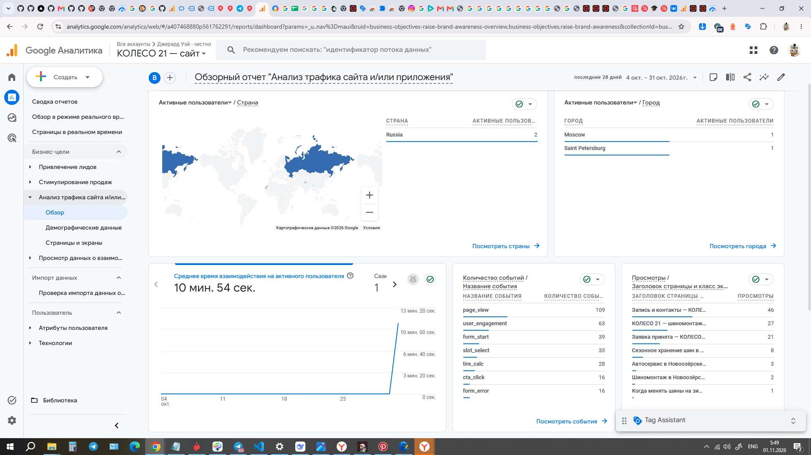

# Домашняя работа № 3 · Тег на сайте, источник и отчёты GA4

**Дисциплина:** ОП.03 «Информационные технологии»

| Поле | Значение |
|---|---|
| Фамилия, имя, отчество | Станчинская Соня |
| Группа | РПО 25/9/3 |
| Номер работы | 3 |
| Тема работы | Установка Google Tag, источник перехода и отчёты GA4 |
| Дата сдачи | пу пу пуу... |

---

## 1. Мой сайт и мой ресурс

| Поле | Значение |
|---|---|
| Адрес репозитория сайта | [ВСТАВЬ ССЫЛКУ НА СВОЙ GITHUB] |
| Публичный адрес сайта | https://tz-21-shinomentazh-koleso21.vercel.app/ |
| Статус публикации | READY |
| Analytics Account | КОЛЕСО 21 |
| Property | КОЛЕСО 21 — сайт |
| Stream name | Сайт КОЛЕСО 21 |
| Website URL в потоке | https://tz-21-shinomentazh-koleso21.vercel.app/ |
| Measurement ID (`G-…`) | G-SKPXPFBT0C |
| Страницы с тегом | Все 9 страниц (включая 404.html) |

Тег ставится на каждую страницу по одному разу: две копии дают двойные
события.

## 2. Тег установлен

**Результат проверки из инструкции тега:**

> Тег Google обнаружен. В потоке данных "Сайт КОЛЕСО 21" успешно зафиксированы данные. Отправка событий работает корректно (проверено через Tag Assistant и Realtime).

Скриншот: 

Скриншот: 

## 3. События доходят до аналитики

| Поле | Значение |
|---|---|
| Дата и время проверки | 01.11.2026, 01:20 |
| Какие страницы открывали | Главная, Шиномонтаж, Контакты |
| Какие события появились в Realtime | page_view, scroll, user_engagement |
| Число активных пользователей в момент проверки | 1 |

Скриншот: 

## 4. Источник перехода определился

Ссылка собирается с метками `utm_source`, `utm_medium`, `utm_campaign`
и открывается на своём сайте.

**Ссылка целиком:**

https://tz-21-shinomentazh-koleso21.vercel.app/?utm_source=telegram&utm_medium=social&utm_campaign=winter_tires_2026&utm_content=test

| Поле | Значение |
|---|---|
| Где в GA4 виден источник | Отчеты -> Привлечение -> Привлечение трафика |
| Какое значение источника показал GA4 | telegram direct vk (g4 слишком новым чтобы эта отобразить...) |
| Совпадает с `utm_source` из ссылки | да |

Скриншот: 

## 5. Статистика на странице «Отчёты»

| Показатель | Значение | Период |
|---|---|---|
| Пользователи | 3 | Последние 28 дней |
| Сеансы | 4 | Последние 28 дней |
| События | 352 | Последние 28 дней |
| Самое частое событие | page_view (109 раз) | Последние 28 дней |

Скриншот: 

**Что видно по этим числам** (2–3 предложения):

> По данным отчетов видно, что сайт посещают реальные пользователи, которые активно взаимодействуют с контентом (352 события). Самое частое событие — `page_view` (109 просмотров), что подтверждает, что люди переходят по страницам. Также фиксируются кастомные события (например, `tire_calc` и `form_start`), что доказывает корректную работу установленного тега и скриптов аналитики.

## 6. Что не получилось

Все шаги выполнены успешно. Тег установлен, данные передаются, источники фиксируются.

## 7. Использование ИИ

| Вопрос | Ответ |
|---|---|
| Что сделано самостоятельно | Вставил код тега на все страницы, настроил UTM-метки, проверил работу через Tag Assistant и сделал скриншоты. |
| Что спросил у модели | Помощь в формулировке вывода по статистике и проверка структуры файла. |
| Что после этого изменил | Внес реальные цифры из своего аккаунта GA4 в таблицу статистики. |
