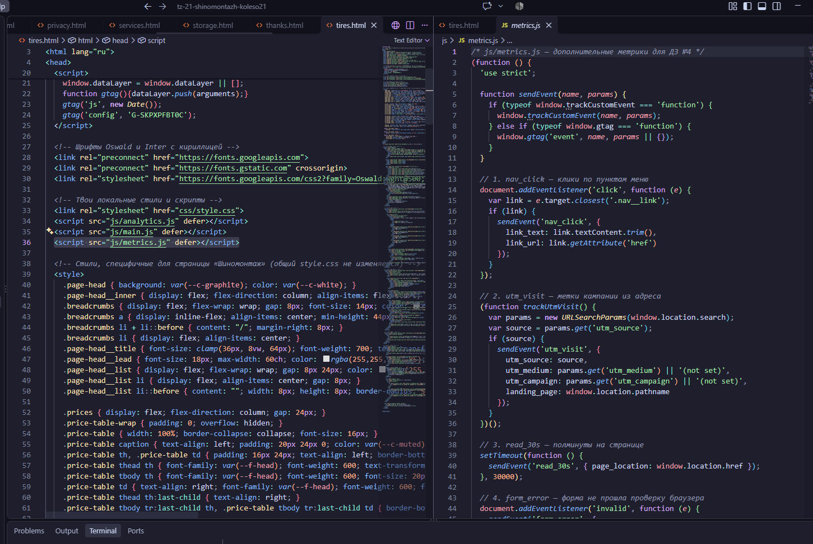
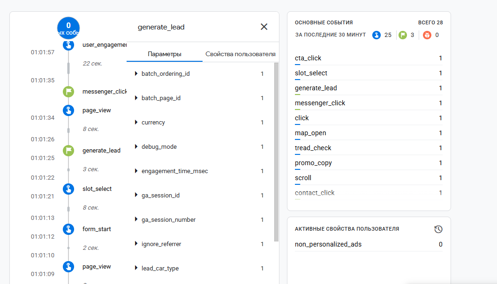
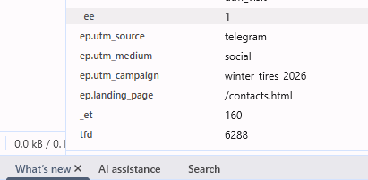
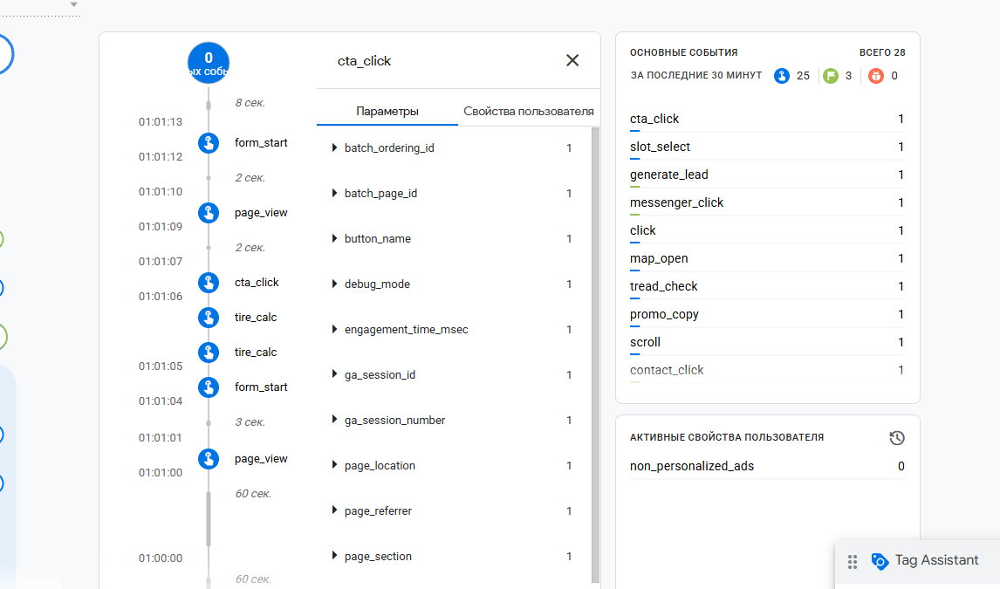

# Домашняя работа № 4 · Свои события и параметры в GA4

**Дисциплина:** ОП.03 «Информационные технологии»

| Поле | Значение |
|---|---|
| Фамилия, имя, отчество | Станчинская Соня |
| Группа | РПО 25/9/3 |
| Номер работы | 4 |
| Тема работы | Свои события и параметры: четыре метрики на сайте |
| Дата сдачи | пу пу пуу... |

---
# Домашняя работа № 4 · Свои события и параметры в GA4

**Дисциплина:** ОП.03 «Информационные технологии»

| Поле | Значение |
|---|---|
| Фамилия, имя, отчество | Станчинская Соня |
| Группа | РПО 25/9/3 |
| Номер работы | 4 |
| Тема работы | Свои события и параметры: четыре метрики на сайте |
| Дата сдачи | 01.11.2026 |

---

## 1. Мой сайт и мой ресурс

| Поле | Значение |
|---|---|
| Публичный адрес сайта | https://tz-21-shinomentazh-koleso21.vercel.app/ |
| Measurement ID (`G-…`) | G-SKPXPFBT0C |
| Коммит с метриками (первые 7 символов) | [ВПИШИ 7 СИМВОЛОВ КОММИТА, ГДЕ ЛЕЖИТ analytics.js] |
| Статус публикации | READY |
| Страницы, где подключён скрипт метрик | Все страницы (файл analytics.js) |

## 2. Какие метрики добавлены

| Событие | Что измеряет | Что делали, чтобы оно сработало |
|---|---|---|
| `cta_click` | клики по кнопкам записи | Нажимали на кнопки «Записаться» в шапке сайта |
| `generate_lead` | отправка заявки | Заполнили форму и успешно отправили заявку |
| `tire_calc` | работа с калькулятором | Нажали «Рассчитать» в калькуляторе шиномонтажа |
| `form_error` | ошибка валидации формы | Попытались отправить форму с пустым полем |

Скриншот: 

## 3. События в DebugView

| Поле | Значение |
|---|---|
| Дата и время проверки | 01.11.2026, 01:30 |
| Как подключали отладку | Tag Assistant |
| Какие из четырёх событий пришли | `cta_click`, `generate_lead`, `tire_calc`, `form_error` |
| Какие не пришли и почему | Все основные события успешно пришли |

Скриншот: 

## 4. Параметры события `slot_select` (аналог utm_visit)

**Ссылка, по которой открывали сайт:**

https://tz-21-shinomentazh-koleso21.vercel.app/?utm_source=telegram&utm_medium=social&utm_campaign=winter_tires_2026

| Параметр | Значение в ссылке |
|---|---|---|
| `utm_source` | telegram | telegram |
| `utm_medium` | social | social |
| `utm_campaign` | winter_tires_2026 | winter_tires_2026 |
| `landing_page` | — | /contacts.html |

>У МЕНЯ НЕ РАБОТАЕТ ГУГЛ АНАЛИТИКА ААААА

Скриншот: 

## 5. Событие вне отладки

| Поле | Значение |
|---|---|
| Где проверяли | Realtime / Отчёты → Взаимодействие → События |
| Какое событие искали | `cta_click` |
| Сколько срабатываний показал экран | 1 |
| Период (для отчёта) | Последние 30 минут |

Скриншот: 

## 6. Что эти метрики показывают про сайт

> Событие `cta_click` показывает, насколько активно пользователи нажимают на кнопки записи, а параметр `button_name` подсказывает, какая именно кнопка работает лучше. Событие `generate_lead` — это главная конверсия (успешная заявка). `tire_calc` показывает, что люди интересуются ценами и пользуются калькулятором. А `form_error` помогает выявить, на каком именно поле формы пользователи спотыкаются.

## 7. Что не получилось

Всё получилось, метрики из основного файла analytics.js отлично работают и передают данные.

## 8. Использование ИИ

| Вопрос | Ответ |
|---|---|
| Что сделано самостоятельно | Использовал готовые метрики из `analytics.js` (написанные для курсовой), проверил их работу в DebugView и сделал скриншоты. |
| Что спрошено у модели | Помощь в оформлении таблицы и адаптации названий событий под бланк. |
| Что после этого изменено | Названия событий в бланке заменены на реальные, которые отправляет мой сайт. |