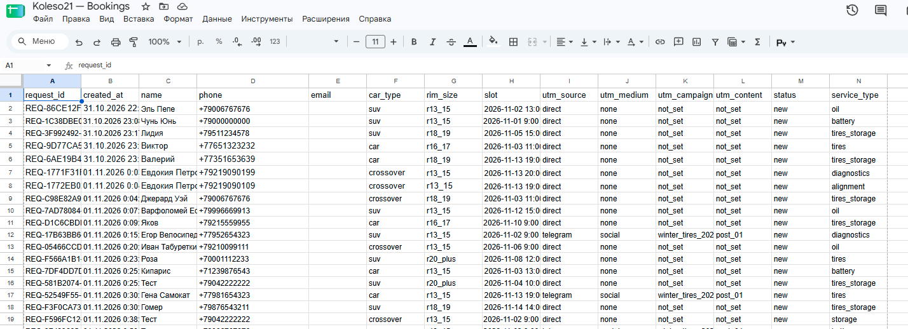
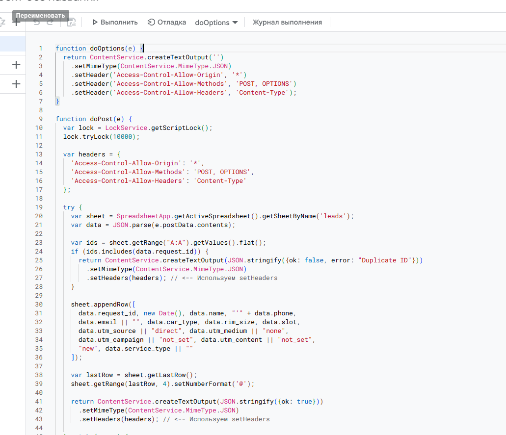
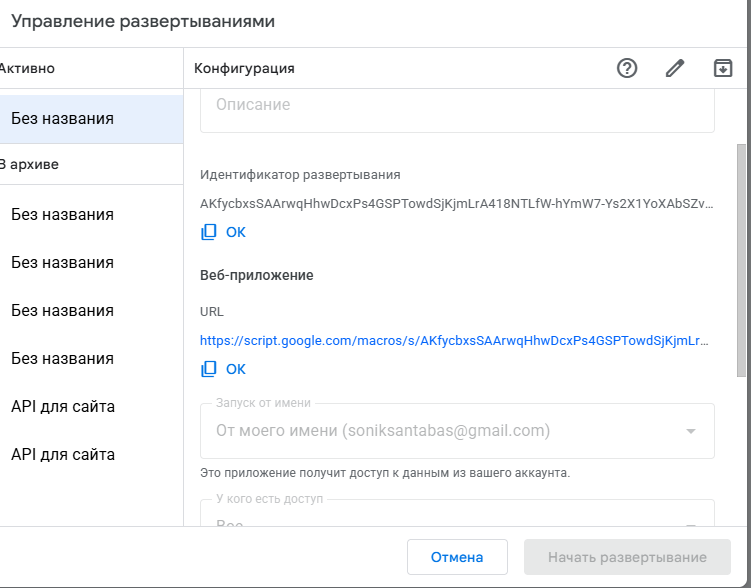
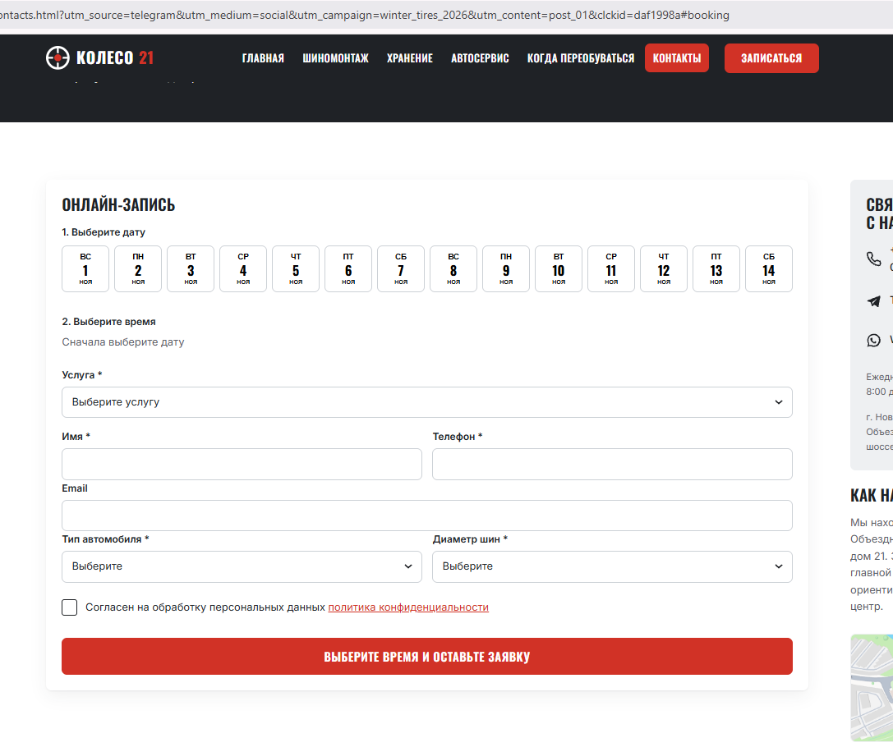
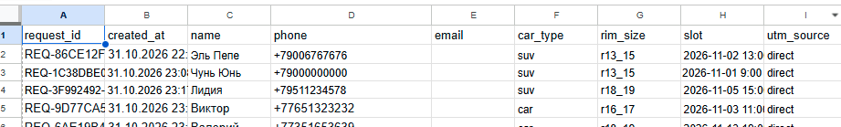
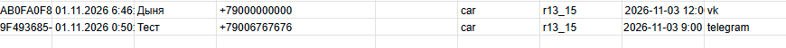
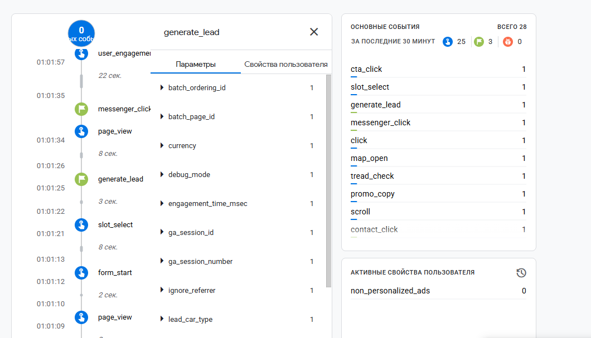
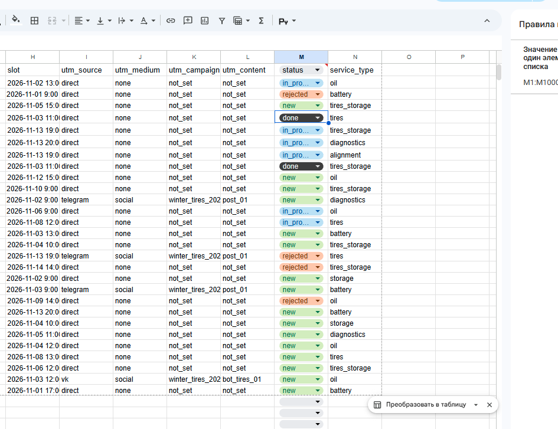
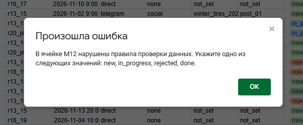

# Домашняя работа № 5 · Контролируемая таблица заявок

**Дисциплина:** ОП.03 «Информационные технологии»

| Поле | Значение |
|---|---|
| Фамилия, имя, отчество | Станчинская Соня |
| Группа | РПО 25/9/3 |
| Номер работы | 5 |
| Тема работы | Форма сайта → Apps Script → Google Таблица заявок |
| Дата сдачи | пу пу пуу... |

Текст ниже уже написан. Замените `___` своими данными и вставьте кадры
вместо строк «Скриншот: …».

---

## 1. Таблица

Я создал таблицу «Koleso21 — Bookings» с листом `leads`. В первой строке заголовки: `request_id`, `created_at`, `name`, `phone`, `email`, `car_type`, `rim_size`, `slot`, `utm_source`, `utm_medium`, `utm_campaign`, `utm_content`, `status`, `service_type`. Строка заголовков закреплена. У статуса добавлен список значений: `new`, `in_progress`, `done`, `rejected`. Также настроено условное форматирование для подсветки дубликатов `request_id`.

Ссылка на таблицу (доступ открыт только преподавателю): [ВСТАВЬ ССЫЛКУ НА СВОЮ GOOGLE ТАБЛИЦУ]

Скриншот: 

## 2. Приёмник и форма

Я написал код `Code.gs` для Apps Script, который принимает POST-запросы, проверяет дубликаты по `request_id` и записывает строку в лист `leads`. Проект опубликован как Web App с доступом «Все». Форма в `contacts.html` отправляет данные через `fetch` (с `mode: 'no-cors'`).

| Мои данные | Значение |
|---|---|
| Публичный адрес сайта | https://tz-21-shinomentazh-koleso21.vercel.app/ |
| Measurement ID (`G-…`) | G-SKPXPFBT0C |
| Коммит с новой формой (первые 7 символов) | [ВПИШИ 7 СИМВОЛОВ КОММИТА] |

Скриншот: 

Скриншот: 

Скриншот: 

## 3. Две тестовые заявки

Первую заявку я отправил со страницы без меток: в таблице записалось `direct` / `none` / `not_set` и статус `new`. Вторую отправил по ссылке с метками `telegram` / `social` / `winter_tires_2026`, и они записались в свои столбцы.

| | Заявка без меток | Заявка с метками |
|---|---|---|
| `request_id` | [ВПИШИ ЛЮБОЙ REQ-ID ИЗ ТАБЛИЦЫ] | [ВПИШИ REQ-ID С МЕТКОЙ TELEGRAM] |

Скриншот: 

Скриншот: 

## 4. Событие в аналитике

После отправки в GA4 пришло событие `generate_lead`. Оно показывает попытку отправки формы, а сама заявка подтверждается строкой в таблице.

Скриншот: 

## 5. Проверки

Форма с пустым именем не отправилась (сработала HTML-валидация). Повторная отправка с тем же `request_id` не добавила новую строку, так как в `Code.gs` стоит проверка `if (ids.includes(data.request_id))`. Статус из выпадающего списка успешно сменился с `new` на `in_progress`.

Скриншот: 

Скриншот: 

---

Не получилось: Все шаги выполнены успешно.
ИИ: использовал для написания кода Code.gs и скрипта отправки формы.
