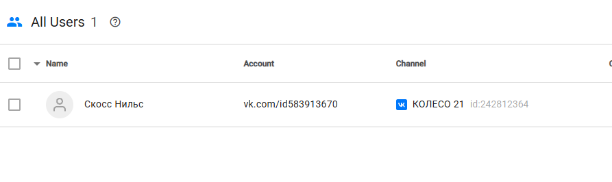
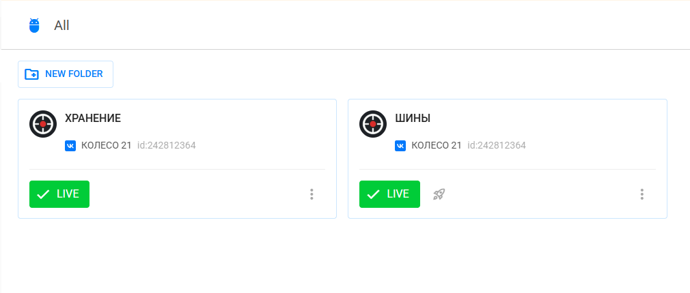
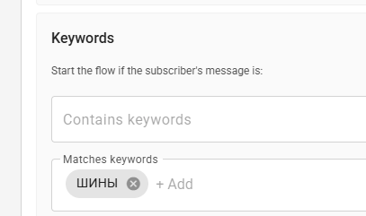
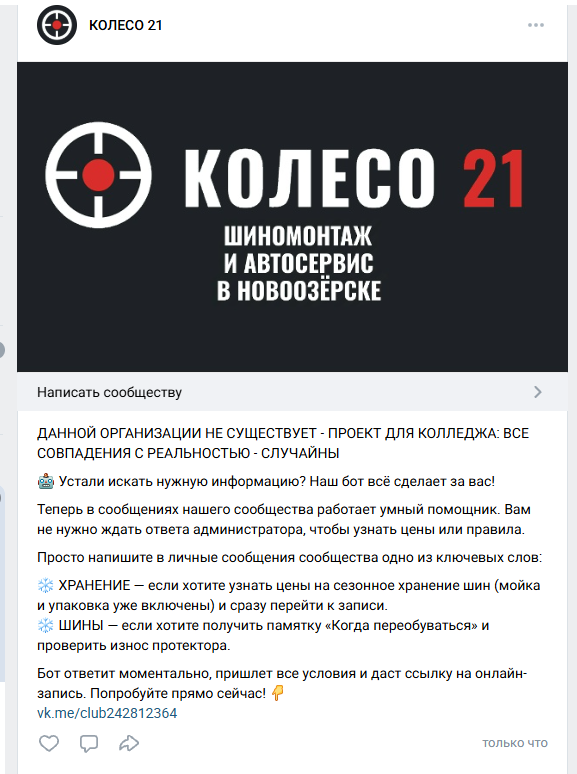
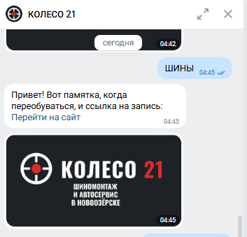
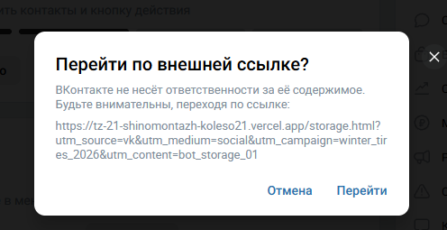
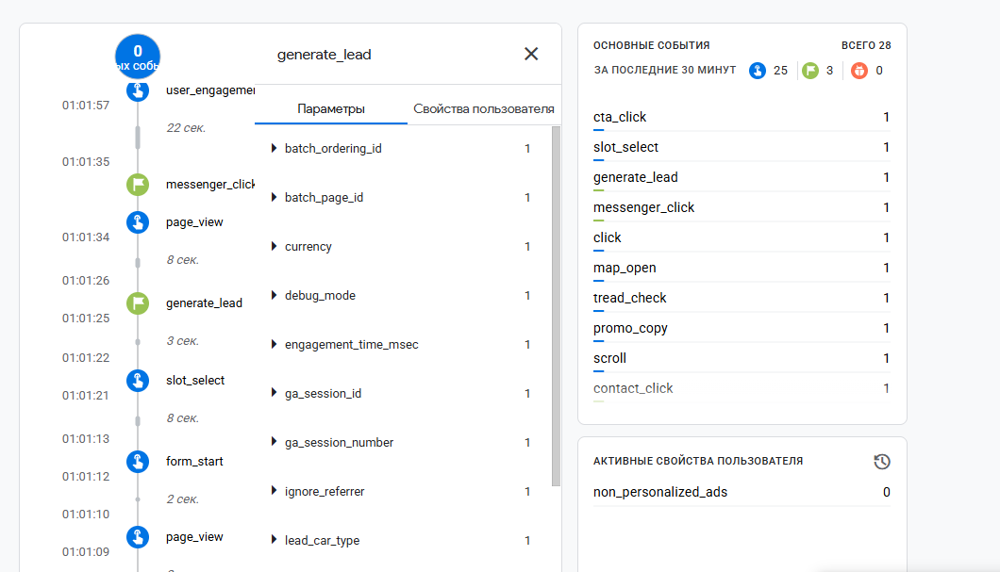
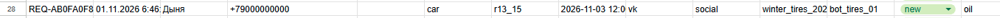

# Домашняя работа № 7 · Instagram → ManyChat → заявка

**Дисциплина:** ОП.03 «Информационные технологии»

| Поле | Значение |
|---|---|
| Фамилия, имя, отчество | Станчинская Соня |
| Группа | РПО 25/9/3 |
| Номер работы | 7 |
| Тема работы | Автоворонка из Instagram: комментарий → сообщение → сайт → заявка |
| Дата сдачи | пу пу пуу... |

Текст ниже уже написан. Замените `___` своими данными и вставьте кадры
вместо строк «Скриншот: …».

---

## 1. Подключение и automation

В связи с невозможностью регистрации в Instagram (техническая блокировка Meta) автоворонка настроена для сообщества ВКонтакте через сервис BotHelp на тарифе Free. 
Собрана автоматизация: триггер на ключевые слова (`ШИНЫ`, `ХРАНЕНИЕ`), отправка сообщения с логотипом и кнопка со ссылкой на сайт (с UTM-метками). Автоматизация включена в режиме Live.

| Мои данные | Значение |
|---|---|
| Сообщество ВК | https://vk.ru/club242812364 |
| Публичный адрес сайта | https://tz-21-shinomentazh-koleso21.vercel.app/ |
| Measurement ID (`G-…`) | G-SKPXPFBT0C |

Скриншот: 
Скриншот: 
Скриншот: 

## 2. Тест цепочки

С другого аккаунта я написал в сообщения сообщества слово `ШИНЫ`. В ответ пришло сообщение с кнопкой «Записаться». Кнопка открыла страницу `winter-tips.html` с метками в адресе, оттуда я перешёл к форме и отправил тестовую заявку. Также протестирована ветка `ХРАНЕНИЕ`.

Скриншот: 
Скриншот: 
Скриншот: 

## 3. Результат

В GA4 пришли `page_view` со страницы `winter-tips.html` и `generate_lead`.
В листе `leads` появилась строка с метками `vk` / `social` / `bot_tires_01` и статусом `new`.

`request_id` заявки: [REQ-AB0FA0F8-3864-48F1-9D46-3B8933AA656D]

Скриншот: 
Скриншот: 

---

Не получилось: Instagram заменен на ВК из-за блокировки регистрации.

ИИ: использован для настройки BotHelp и написания сценария.